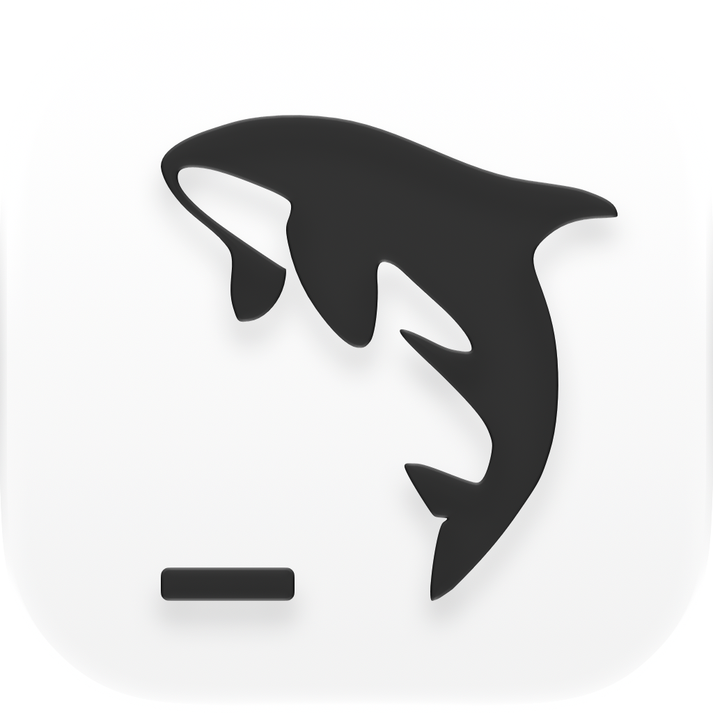
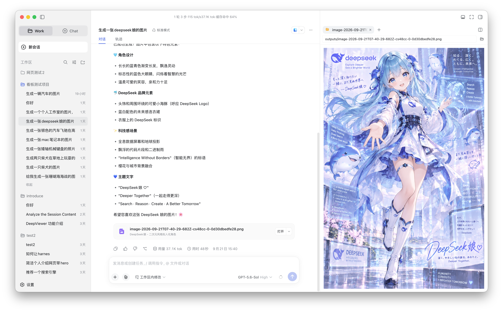
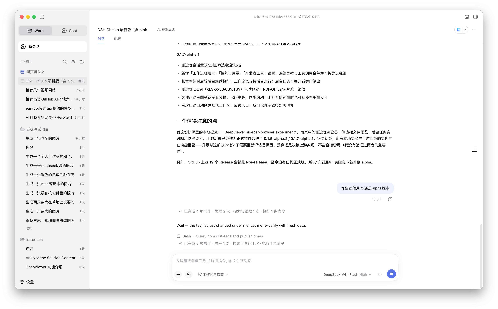
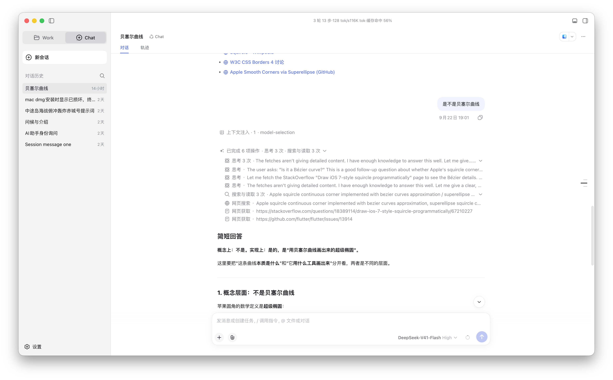
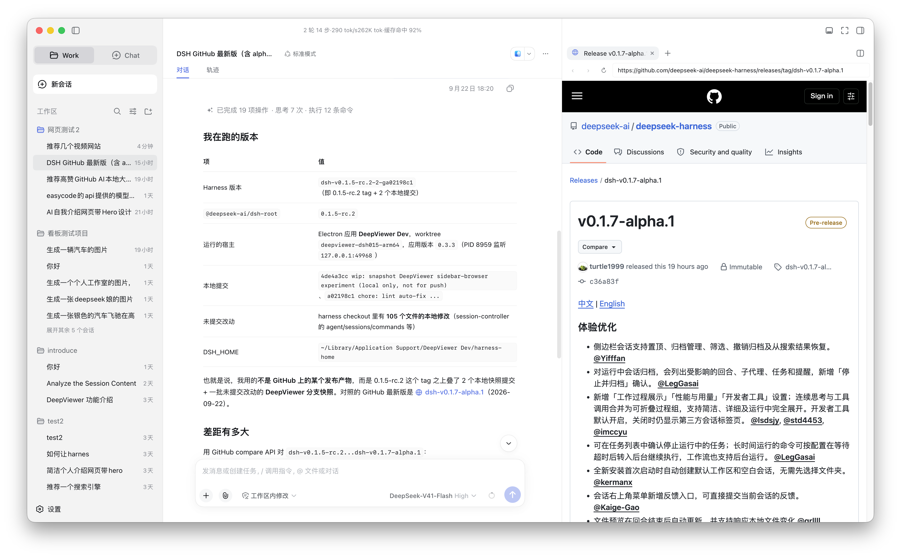
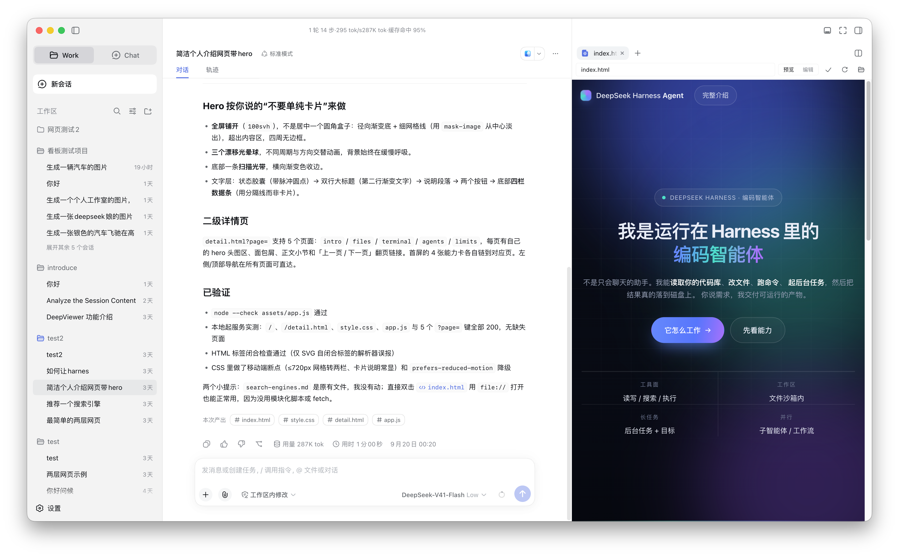
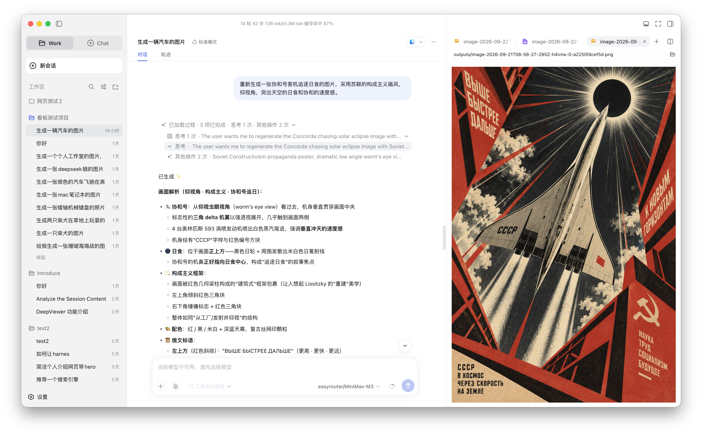
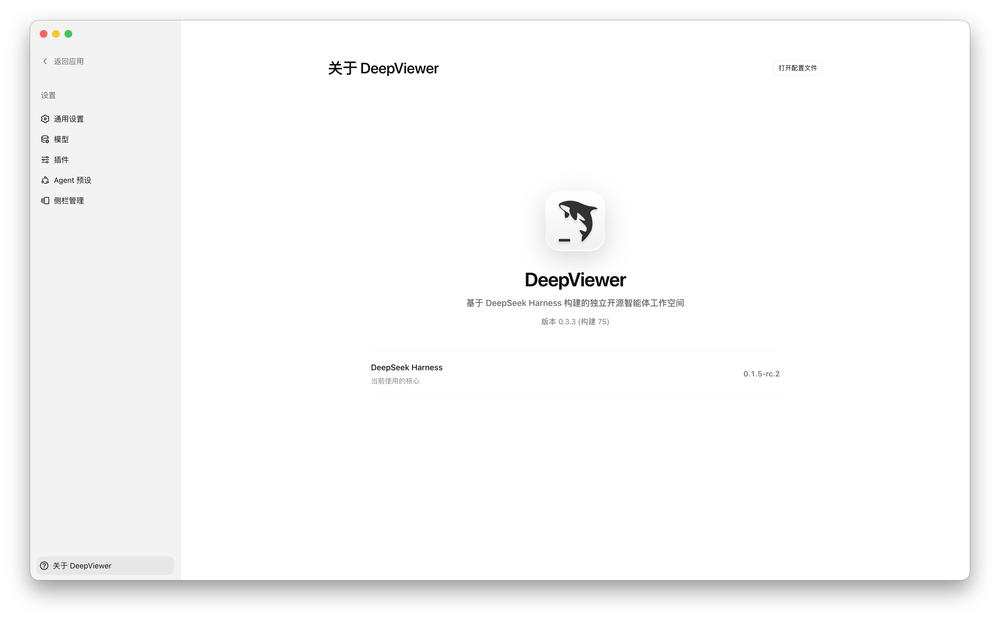

<p align="center">
  
</p>

<h1 align="center">DeepViewer</h1>

<p align="center">
  针对设计师优化的专用 Agent 工作台。
</p>

<p align="center">
  <a href="https://github.com/Duoasa/DeepViewer/releases"></a>
  <a href="https://github.com/Duoasa/DeepViewer/actions/workflows/ci.yml"></a>
  
  
  <a href="LICENSE"></a>
  <a href="https://github.com/deepseek-ai/deepseek-harness/discussions/2828"></a>
</p>

<p align="center">
  <a href="https://github.com/Duoasa/DeepViewer/releases/download/v0.7.3/DeepViewer-0.7.3-arm64.dmg"><strong>下载 0.7.3（ARM64）</strong></a>
  ·
  <a href="#073-更新">本版更新</a>
  ·
  <a href="#安装与数据">隐私与数据</a>
  ·
  <a href="#从源码构建">从源码构建</a>
</p>

<p align="center">
  <a href="README.md">English</a> · <strong>简体中文</strong>
</p>

DeepViewer 是针对设计师优化的开源专用 Agent 工作台，基于
[DeepSeek Harness](https://github.com/deepseek-ai/deepseek-harness)。从设计探索、
参考图重建，到 Figma 可编辑图层、素材处理和可运行原型，在同一个桌面工作区中完成。
0.7.3 原生集成 DSH-to-Figma，保留现有 DeepViewer 界面、Work/Chat、文件交付、侧栏工作台和会话图谱。

<p align="center">
  
</p>

> [!NOTE]
> DeepViewer 是独立社区项目，与 DeepSeek 没有从属或官方背书关系。

> [!IMPORTANT]
> 当前正式版本为 **DeepViewer 0.7.3 / Build 93**，内置 DeepSeek Harness `0.2.1-rc.2`，**仅支持 Apple Silicon arm64**。DMG 已从源码全新构建，完成 Developer ID 签名和 Apple 公证。维护者已确认升级开发版界面正常；真实账户、其余交互及迁移会话/设置/附件仍保留独立的人工验收边界。

> [!TIP]
> [0.7.3 Release](https://github.com/Duoasa/DeepViewer/releases/tag/v0.7.3) 提供 [SHA-256 校验清单](https://github.com/Duoasa/DeepViewer/releases/download/v0.7.3/SHA256SUMS.txt)。安装版和开发版使用相互独立、与版本号无关的数据目录；重大升级前请备份。上一版本 [0.5.1](https://github.com/Duoasa/DeepViewer/releases/tag/v0.5.1)、历史 [0.3.3 / Build 75](https://github.com/Duoasa/DeepViewer/releases/tag/v0.3.3) 及其 SHA-256 清单、历史 [0.2.5 版本](https://github.com/Duoasa/DeepViewer/releases/tag/v0.2.5-preview.1) 仍可下载。

> [!NOTE]
> 下方 DeepViewer 界面截图为 **0.3.3 / Build 75 历史参考**；Figma 图片来自 DSH-to-Figma 上游产品示例，均不作为本次集成的视觉验收证据。

## 0.7.3 更新

- 原生内置 **DSH-to-Figma 0.2.1** 工具与 Figma 工作流技能，无需另外安装 DSH 插件包。
- 明确面向设计师：从参考图和设计上下文，走向可编辑图层、素材和可运行原型。
- 本机私有配对、安装版与开发版独立连接端口，保留已有插件设置。现有前端和 DSH `0.2.1-rc.2` 内核保持不变。

安装包验证与人工验收边界见 [0.7.3 发布记录](docs/sdd/releases/v0.7.3.md)。DeepViewer 中真实 Figma 配对、编辑与导出仍待维护者验收。

## 原生 DSH-to-Figma

[DSH-to-Figma](https://github.com/Duoasa/DSH-to-Figma) 将 Agent 接入 Figma 原生
Plugin API，可读取设计上下文，创建和编辑画板、文本、自动布局、组件与变量，获取截图并导出素材。
生成的设计保留为 Figma 可编辑图层。


*图片来自 DSH-to-Figma v0.2.1（MIT）产品示例：参考图重建、原生图层和 1440 × 900 画板。
这是上游实例，不是本次 DeepViewer 集成的验收截图。*

1. 打开带本地工作区的 **Work** 会话，告诉 Agent：“帮我设置 Figma，给出配套插件的 manifest 路径。”Agent 会调用 `figma_setup`。
2. 在 Figma Desktop 中选择 **Plugins → Development → Import plugin from manifest**，导入生成的 `manifest.json`，在目标 Design 文件中运行 **DSH to Figma · Local**，保持插件窗口打开。
3. 让 DeepViewer 检查连接（`figma_status`）并描述想要的修改。只有一个连接文件时自动选用，多个文件时需要明确选择。

配对文件保存在当前应用数据目录的 `harness-home/figma`，其中含本机凭证，请勿分享或移动该文件夹。
安装版使用本机回环端口 **3065**，开发版使用 **3066**，与独立 DSH 默认的 **3055** 分开；
已有显式端口和后端设置优先。端口冲突时保留诊断工具，不阻断 Agent 启动；可关闭冲突实例，
或在 desktop profile patch 的 `deepviewer-figma` 行设置其他 `bridgePort` 后重启。
`DEEPVIEWER_DISABLE_FIGMA=1` 可停用模块；停用选择会保存在 profile 中，恢复时移除对应的 `disabled: true` 覆盖。

画布操作要求 Work 工作区与已连接的配套插件。本地模式不提供云端专属生成能力；官方 Figma
桌面/远程 MCP 属于独立后端，受其可用性和权限约束。

## 0.5.0 从 0.3.3 迁移的功能变化

| 领域 | 0.5.0 的变化 |
| --- | --- |
| 原生桌面 | 从旧自建桌面壳和 DSH 0.1.5 覆盖层迁移到官方 Electron/DesktopHost 与固定 DSH `0.2.0-rc.2`，以 Scoder `0.7.0 / Build 43` 为源码基线。 |
| Work、Chat 与会话图谱 | 保留依赖工作区的 Work 和无工作区的 Chat，增加内置 Synapse 会话图谱，用于查看会话关联与上下文。 |
| 侧栏工作台 | Harness 原生面板承接独立 Better Sidebar 的挂载；DeepViewer 保留文件/编辑器/Git 操作、会话相对路径、桌面浏览器集成与权限检查。 |
| 内置模块 | subscriptions `0.3.1` 和 model-capabilities `1.0.2` 作为应用模块内置；模型能力模块替代旧 reasoning 插件，并承接其支持的设置。 |
| 文件与外观 | 保留附件交付和工作区预览，在原生壳中恢复 DeepViewer 品牌，跟随桌面/系统外观。 |
| 开发稳定性 | 文件同步仅改变产物元数据时保留已挂载的界面；真实源码变化和完成构建的时间戳仍触发热更新。 |
| 升级连续性 | 保留稳定版/开发版独立数据根目录，在新内核打开存储前快照旧 DeepViewer 数据，保留迁移与回滚备份；Scoder 和 Saidex 数据不作为迁移候选。 |
| 网络 | 保留系统代理/PAC、显式代理、限定范围的 loopback/RPC 鉴权与内网访问授权边界。 |

独立 Better Sidebar 和 reasoning 插件退出挂载，由本次迁移的原生功能与模型能力模块承接。Taskboard 保持移除，历史预览插件保持停用。包体证据见 [0.5.0 发布记录](docs/sdd/releases/v0.5.0.md)，人工验收边界见[规格](docs/sdd/specs/DV-0033-scoder-native-rebase/spec.md)；[0.3.3 发布记录](docs/sdd/releases/v0.3.3.md)仅提供历史证据。

### Work、Chat 与过程披露

Work 按项目组织会话，Chat 可以脱离工作区保存对话。两种模式都能在启动后恢复历史；同类上下文、思考、搜索和操作会合并为可展开的摘要。





### 文件与侧栏工作台

侧栏可以查看工作区文件、预览生成的 HTML，并与对话并排浏览网页。文件路径、面板导航和浏览器访问都与当前桌面会话关联。





### 图片生成与附件交付

生成文件以具有可用名称和后缀的附件卡片交付。即使图片最初生成在工作区外，也会复制到会话工作区，让附件与侧栏预览指向同一个文件。




### 外观与版本信息

设置页跟随桌面外观，“关于”页面展示应用构建号和内置 Harness 版本。



## 安装与数据

1. 下载 [DeepViewer-0.7.3-arm64.dmg](https://github.com/Duoasa/DeepViewer/releases/download/v0.7.3/DeepViewer-0.7.3-arm64.dmg)，并用 [0.7.3 Release](https://github.com/Duoasa/DeepViewer/releases/tag/v0.7.3) 中的 [SHA256SUMS.txt](https://github.com/Duoasa/DeepViewer/releases/download/v0.7.3/SHA256SUMS.txt) 校验。
2. 打开 DMG，将 `DeepViewer.app` 复制到“应用程序”。
3. 打开应用并配置模型提供方或订阅账户。无需全局安装 Node.js 或 Harness。

本地服务仅监听随机 loopback 端口。安装版数据固定存放于 `~/Library/Application Support/DeepViewer`，开发版固定存放于 `~/Library/Application Support/DeepViewer Dev`。覆盖安装应用不会替换这些目录；首次迁移会先复制、校验并保留备份。重大升级前仍建议自行备份。

0.7.3 Build 93 安装包已全新构建，完成 Developer ID 签名和 Apple 公证。bounded smoke 共 122 项通过；包体净化、完整性和运行时验证证据见 [0.7.3 发布记录](docs/sdd/releases/v0.7.3.md)。

真实用户环境扫描受保护的 Office 字体目录可能等待，字体权限仍需人工验收。本次仅发布安装包，不发布自动更新 feed。

## 开源引用与 DeepViewer 修改

| 组件 | 来源与许可证 | DeepViewer 的修改 |
| --- | --- | --- |
| Agent 内核与原生壳 | [DeepSeek Harness](https://github.com/deepseek-ai/deepseek-harness)，MIT，固定在 `687f282e8625c6b8d11ff58211a90524be2e4317`（`0.2.1-rc.2`） | 官方 Electron/DesktopHost 加 [DeepViewer adapter](apps/deepviewer-adapter) 与经过检查的兼容契约；Agent Loop 仍由上游维护。 |
| 桌面源码基线 | [Duoasa/scoder](https://github.com/Duoasa/scoder)，`0.7.0 / Build 43`，固定在 `e277adc6ce512655095e6f65c63bdc72d24bae95`；保留原始版权说明 | 恢复 DeepViewer 品牌、包名/更新目标和数据隔离，保留原生功能，修复元数据变化引发的界面热卸载；不导入 Scoder 发布记录与用户数据。 |
| 订阅与图片工具 | [V1ki/dsh-plugin-subscriptions](https://github.com/V1ki/dsh-plugin-subscriptions)，MIT，`0.3.1` | 内置 DSH 0.2.1 兼容模块，限定范围 RPC/loopback 检查、剩余额度显示及图片生成状态样式。 |
| 侧栏来源 | [omdsh-dev/DSH-better-sidebar](https://github.com/omdsh-dev/DSH-better-sidebar)，MIT | 独立插件退出挂载，工作台由 Harness 原生面板承接；复用工作流代码保留来源与版权。 |
| 模型能力 | [DeepViewer model-capabilities 模块](apps/dsh-plugin-model-capabilities)，MIT，`1.0.2` | 提供方/模型扫描和推理/多模态配置，替代旧 `dsh-plugin-reasoning` 挂载并承接支持的设置。 |
| 会话图谱 | [Vendored Synapse 源码](apps/deepviewer-adapter/workflows/vendor/synapse)，保留原始许可证和来源记录 | 在 DeepViewer adapter 中内置会话图谱集成。 |

历史第一方预览插件已停用，改用 Harness 官方预览。[dashi-taskboard](https://github.com/chuspeeism/dashi-taskboard) 曾参与评估，现已移除，Runtime 不再包含 Taskboard。上游版权和第三方许可证仍归各项目所有。

## 从源码构建

需要 macOS arm64、Node.js 24+、pnpm 11.19.0，以及选为当前开发工具链的 Xcode 26 或更新版本。开发应用和安装包均需使用 Apple `actool` 编译原生 `.icon` 资源。bootstrap 获取固定的 Harness 源码并应用经过检查的适配契约，不依赖用户数据或预构建应用。

```sh
git clone https://github.com/Duoasa/DeepViewer.git
cd DeepViewer
pnpm install --frozen-lockfile
node apps/deepviewer-desktop/scripts/bootstrap-native-upstream.mjs
pnpm --dir upstream/deepseek-harness install --frozen-lockfile
pnpm desktop:dev
```

`pnpm desktop:dev` 会构建并启动使用独立数据目录的 DeepViewer Dev；`pnpm desktop:dev:restart` 重启本项目开发进程，`pnpm desktop:build` 仅构建、不启动。开发构建会递增本地 Build 号。

基础验证使用 `pnpm typecheck` 和 `pnpm desktop:smoke`，原生集成及适配契约检查见 [CI 流程](.github/workflows/ci.yml)。`pnpm desktop:preview` 制作本地预览包；`pnpm desktop:release` 准备签名 arm64 DMG/ZIP，需要设置 `DEEPVIEWER_SIGN_IDENTITY`、`DEEPVIEWER_TEAM_ID` 、`DEEPVIEWER_NOTARY_PROFILE` 和 `CSC_KEYCHAIN`，不会自动发布。签名/公证凭据留在本机，notary profile 保存在钥匙串。

[0.3.3 源码快照说明](upstream/snapshots/v0.3.3/README.md)保留为 Build 75 的历史复现指南，不用于 0.5.0 及之后版本的构建。

[SDD 文档](docs/sdd/README.md)记录架构、插件来源、需求和验证。DeepViewer 原创代码采用 [MIT License](LICENSE)；各上游许可证继续适用。

问题反馈请到 [GitHub Issues](https://github.com/Duoasa/DeepViewer/issues)，不要附带凭据、私有文件或未脱敏日志。

DSH-to-Figma 0.2.1 (MIT): [source](https://github.com/Duoasa/DSH-to-Figma), [pinned revision and file hashes](vendor/dsh-to-figma/UPSTREAM.json).
